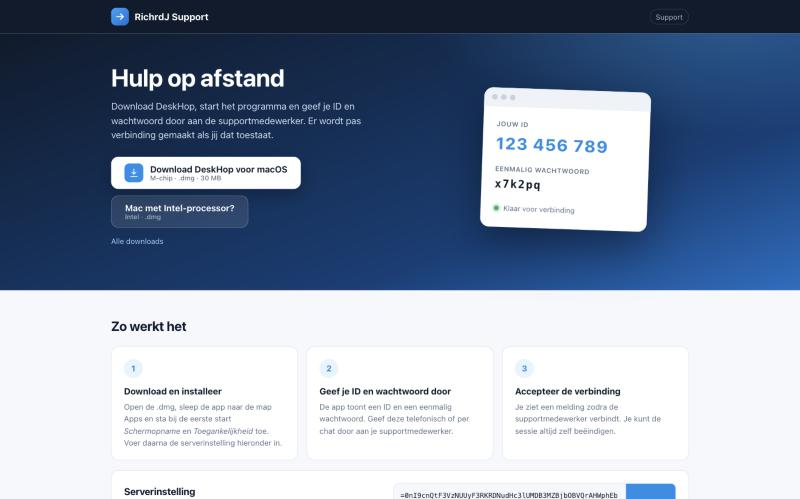
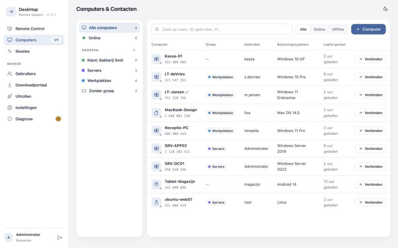
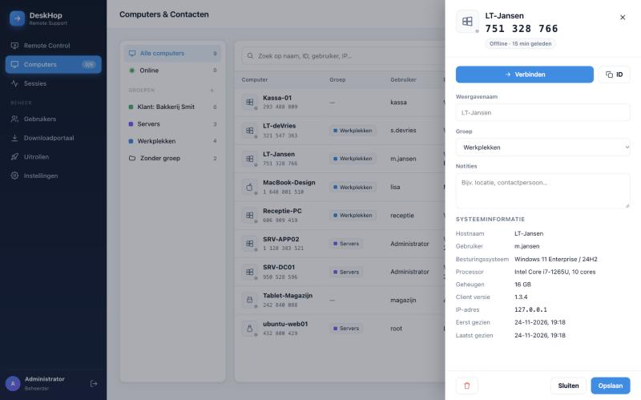
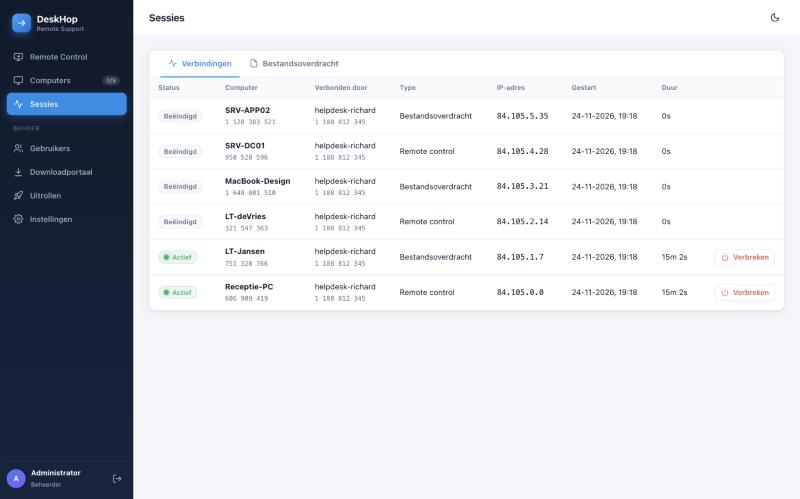
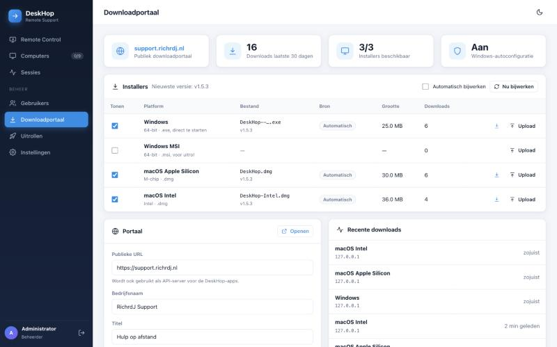

# DeskHop: self-hosted remote support

Een volledig zelf gehoste remote-support-oplossing:

- **`https://support.example.nl/`**: publieke downloadpagina. Die herkent het besturingssysteem (Windows, of macOS met Apple Silicon of Intel) en biedt direct de juiste installer aan.
- **`https://support.example.nl/admin`**: beheerconsole voor computers, sessies, gebruikers en het portaal.

| Service   | Wat                                                                  | Poorten |
|-----------|----------------------------------------------------------------------|---------|
| `id-server`    | ID/rendezvous-server                                      | 21115/tcp, 21116/tcp+udp |
| `relay-server` | relay-server                                              | 21117/tcp |
| `console`      | **DeskHop**: downloadportaal, beheerconsole en API-server  | 21114/tcp |

**Geen poort 80 of 443 nodig.**



## Functies

### Downloadportaal (`/`)
- **Automatische OS-herkenning.** Windows krijgt de `.exe`. Een Mac krijgt de `.dmg` voor Apple Silicon of Intel, met de andere variant als tweede knop.
- **Windows configureert zichzelf.** De `.exe` wordt geleverd als `<Productnaam>--<code>.exe` en start zonder installatie, zoals QuickSupport. De code bevat server, key en API, zodat de app direct met jouw server verbindt, zonder instellingen.
- **Installers via je eigen URL.** De console haalt elke 6 uur de nieuwste release op, cachet die en serveert hem onder je eigen naam (bijv. `DeskHop.dmg`). Je kunt ook een eigen (custom) installer uploaden.
- Stappenuitleg, een serverconfiguratie om te kopiëren (voor Mac), contactgegevens en eigen teksten.

### Beheerconsole (`/admin`)
- **Remote Control**: partner-ID invoeren en direct de support-app openen, plus statistieken, online computers en recente sessies.
- **Computers**: registreren zich automatisch, met hostnaam, gebruiker, OS, CPU, geheugen en IP. Gekleurde groepen, namen, notities, zoeken, online/offline en verbinden met één klik.
- **Sessies (audit)**: wie verbond met welke computer, vanaf welk IP en hoe lang. Actieve sessies kun je **geforceerd verbreken**. Bestandsoverdrachten worden ook gelogd.
- **Downloadportaal**: installers aan- of uitzetten, bijwerken, eigen installers uploaden, downloadstatistieken en portaalteksten.
- **Gebruikers**: technici en beheerders. Na inloggen in de support-app zien ze alle computers onder *Toegankelijke apparaten*, en hun adresboek wordt gesynchroniseerd.
- **Uitrollen**: een configuratie-string en PowerShell- en macOS-scripts voor uitrol via Intune, GPO of RMM.
- Licht en donker thema, responsive, Nederlandstalig. Alleen Python-stdlib, data in SQLite.

| | |
|---|---|
|  |  |
|  |  |
|  |  |

## Installatie

### 1. Stack aanmaken (geen variabelen nodig)

**Portainer:** Stacks → Add stack → plak [stack.yml](stack.yml) → *Deploy the stack*.
**CLI (Swarm):** `docker stack deploy -c stack.yml deskhop`

> De images staan op `ghcr.io/richrdj/deskhop` en `ghcr.io/richrdj/deskhop-server`. Een GHCR-package is standaard **privé**. Zet het eenmalig op public (GitHub → je profiel → Packages → package → *Package settings* → *Change visibility*), of voeg in Portainer `ghcr.io` toe als registry met een token met `read:packages`.

> In Swarm gebruiken de volumes `local` storage. Draai de stack daarom op één node, zodat de servers en de console hetzelfde `server-data`-volume delen.

### 2. Installatiewizard

Open `http://<server>:21114/admin`. De wizard vraagt om:
- je **beheerdersaccount**;
- de **productnaam** en **bedrijfsnaam**;
- de **publieke URL** van het portaal, bijv. `https://support.richrdj.nl`;
- het **adres van de ID-server**: een DNS-naam die direct naar je server wijst, bijv. `rd.richrdj.nl`.

Alles is later aan te passen onder *Instellingen* en *Downloadportaal*, ook een eigen HTTPS-certificaat.
Doe de wizard direct na het deployen: tot er een beheerder is, kan iedereen die de pagina bereikt de installatie afronden.

### 3. DNS en poorten

| Naam                  | Wijst naar | Waarvoor |
|-----------------------|------------|----------|
| `support.richrdj.nl`  | portaal/console (publieke URL) | browser + API van de apps |
| `rd.richrdj.nl`       | **direct** het IP van de server, niet via een proxy | ID- en relay-verbindingen (21115–21117) |

Gebruik je geen proxy of tunnel? Dan mag dit dezelfde naam zijn.
Forward naar de Docker-host: `21114/tcp`, `21115/tcp`, `21116/tcp+udp`, `21117/tcp`.

### 4. `support.richrdj.nl` zonder poort 80/443

**A. Cloudflare Tunnel (aanbevolen).** Geeft een nette `https://support.richrdj.nl` met geldig certificaat, zonder open poorten voor het portaal.
1. Cloudflare Zero Trust → Networks → Tunnels → maak een tunnel en kopieer het token.
2. Public hostname `support.richrdj.nl` → service `http://console:21114`.
3. Haal de `cloudflared`-service in `stack.yml` uit het commentaar en plak het token op de aangegeven plek.
4. Het adres van de ID-server moet dan een andere naam zijn, bijv. `rd.richrdj.nl`, als A-record **zonder** Cloudflare-proxy (grijze wolk).

**B. HTTPS direct op poort 21114.** Plak een certificaat en key (bijv. Let's Encrypt) in *Instellingen → HTTPS-certificaat* en herstart de console. Het portaal draait dan op `https://support.richrdj.nl:21114`. Gebruik een geldig certificaat, want de app accepteert geen self-signed certificaat.

### Optionele environment-variabelen

Niet nodig, maar handig voor geautomatiseerde installaties: `ADMIN_PASSWORD` (maakt `admin` aan en slaat de wizard over), `PUBLIC_URL`, `SERVER_HOST`, `APP_NAME`, `TLS_CERT`/`TLS_KEY`, `INSTALLER_AUTO_UPDATE=0`.

### Klanten: zonder installatie (zoals QuickSupport)

Op Windows krijgt een klant een losse `.exe` die zonder installatie start en direct een ID en een eenmalig wachtwoord toont. De serverinstellingen zitten in de bestandsnaam. De MSI is alleen voor jouw uitrolscripts en staat niet op het klantenportaal.
Op macOS moet de app net als elke remote-support-tool toestemming krijgen voor *Schermopname* en *Toegankelijkheid*. De klant opent de `.dmg`, zet de app in Apps en plakt één keer de serverinstelling.

## Lokaal ontwikkelen

```bash
python3 console/server/app.py        # open http://localhost:21114/admin voor de wizard
# of zonder wizard:
ADMIN_PASSWORD=admin12345 PUBLIC_URL=http://localhost:21114 python3 console/server/app.py
python3 console/server/demo_seed.py http://localhost:21114 admin admin12345   # demodata
```

## Hoe het werkt

De support-app gebruikt `PUBLIC_URL` als **API-server**. DeskHop implementeert dat protocol:

| Endpoint                                | Doel |
|-----------------------------------------|------|
| `POST /api/heartbeat`, `POST /api/sysinfo` | apparaatregistratie, online-status, systeeminfo, sessies verbreken |
| `POST /api/login`, `/api/currentUser`, `/api/logout` | inloggen in de client |
| `GET/POST /api/ab`                      | adresboek (legacy-modus) |
| `GET /api/peers`, `/api/users`, `/api/device-group/accessible` | "Toegankelijke apparaten" |
| `POST /api/audit/conn`, `/api/audit/file` | sessie- en bestandsaudit |
| `GET /download/<platform>`              | installers (`win_exe`, `win_msi`, `mac_arm`, `mac_x64`) |
| `GET /public-api/info`                  | data voor het downloadportaal |

## Licentie

MIT
