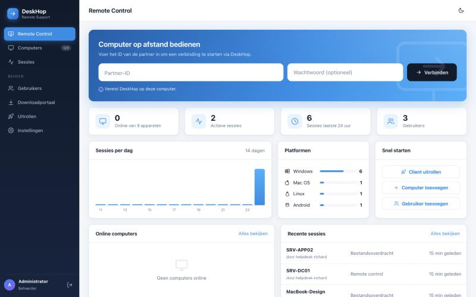
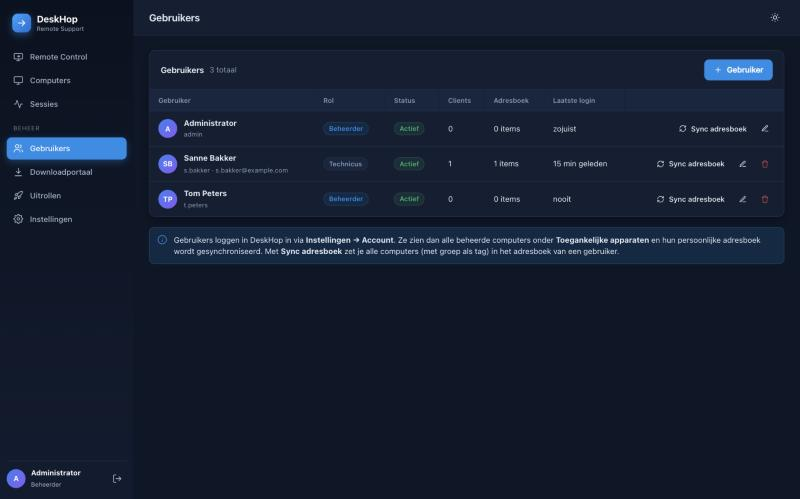

# DeskHop: self-hosted remote support

Een volledig zelf gehoste remote-support-oplossing:

- **`https://support.example.nl/`**: publieke downloadpagina. Die herkent het besturingssysteem (Windows, of macOS met Apple Silicon of Intel) en biedt direct de juiste installer aan.
- **`https://support.example.nl/admin`**: beheerconsole voor computers, sessies, gebruikers en het portaal.

| Service   | Wat                                                                  | Poorten |
|-----------|----------------------------------------------------------------------|---------|
| `id-server`    | ID/rendezvous-server                                      | 21115/tcp, 21116/tcp+udp |
| `relay-server` | relay-server                                              | 21117/tcp |
| `console`      | **DeskHop**: downloadportaal, beheerconsole en API-server  | 21114/tcp |

**Geen poort 80 of 443 nodig.**


## Functies

### Downloadportaal (`/`)
- **Automatische OS-herkenning.** Windows krijgt de `.exe`. Een Mac krijgt de `.dmg` voor Apple Silicon of Intel, met de andere variant als tweede knop.
- **Windows configureert zichzelf.** De `.exe` wordt geleverd als `<Bedrijfsnaam>--<code>.exe`. De code bevat server, key en API, zodat de app direct met jouw server verbindt, zonder instellingen.
- **Installers via je eigen URL.** De console haalt elke 6 uur de nieuwste release op, cachet die en serveert hem onder je eigen naam (bijv. `RichrdJ-Support.dmg`). Je kunt ook een eigen (custom) installer uploaden.
- Stappenuitleg, een serverconfiguratie om te kopiëren (voor Mac), contactgegevens en eigen teksten.

### Beheerconsole (`/admin`)
- **Remote Control**: partner-ID invoeren en direct de support-app openen, plus statistieken, online computers en recente sessies.
- **Computers**: registreren zich automatisch, met hostnaam, gebruiker, OS, CPU, geheugen en IP. Gekleurde groepen, namen, notities, zoeken, online/offline en verbinden met één klik.
- **Sessies (audit)**: wie verbond met welke computer, vanaf welk IP en hoe lang. Actieve sessies kun je **geforceerd verbreken**. Bestandsoverdrachten worden ook gelogd.
- **Downloadportaal**: installers aan- of uitzetten, bijwerken, eigen installers uploaden, downloadstatistieken en portaalteksten.
- **Gebruikers**: technici en beheerders. Na inloggen in de support-app zien ze alle computers onder *Toegankelijke apparaten*, en hun adresboek wordt gesynchroniseerd.
- **Uitrollen**: een configuratie-string en PowerShell- en macOS-scripts voor uitrol via Intune, GPO of RMM.
- Licht en donker thema, responsive, Nederlandstalig. Alleen Python-stdlib, data in SQLite.

| | |
|---|---|
|  |  |
|  |  |
|  |  |

## Installatie

### 1. Image en release via GitHub

Push naar `main` en GitHub Actions bouwt en pusht `ghcr.io/<account>/<repo>:latest` (amd64 en arm64), plus `ghcr.io/<account>/<repo>-server:latest` voor de ID- en relay-server.
Push een tag (`git tag v1.0.0 && git push --tags`) en je krijgt daarnaast `:1.0.0` plus een **GitHub Release** met `stack.yml` als bijlage.

Een GHCR-package is standaard **privé**. Kies één van twee opties:
- maak het package public (GitHub → Packages → Package settings → Change visibility), of
- voeg in Portainer onder *Registries* `ghcr.io` toe met je GitHub-gebruikersnaam en een token met `read:packages`.

### 2. DNS en poorten

Je hebt twee DNS-namen nodig:

| Naam                  | Wijst naar | Waarvoor |
|-----------------------|------------|----------|
| `support.richrdj.nl`  | portaal/console (`PUBLIC_URL`) | browser + API van de clients |
| `rd.richrdj.nl`       | **direct** het IP van de server, niet via een proxy (`SERVER_HOST`) | ID- en relay-verbindingen (21115–21117) |

Gebruik je geen proxy of tunnel? Dan mag dit dezelfde naam zijn.

Forward naar de Docker-host: `21114/tcp`, `21115/tcp`, `21116/tcp+udp`, `21117/tcp`.

### 3. `support.richrdj.nl` zonder poort 80/443

Kies één van deze opties:

**A. Cloudflare Tunnel (aanbevolen).** Hiermee krijg je een nette `https://support.richrdj.nl` met geldig certificaat, zonder open poorten voor het portaal.
1. Cloudflare Zero Trust → Networks → Tunnels → maak een tunnel en kopieer het token.
2. Public hostname `support.richrdj.nl` → service `http://console:21114`.
3. Haal de `cloudflared`-service in `stack.yml` uit het commentaar en zet `CLOUDFLARE_TUNNEL_TOKEN`.
4. `SERVER_HOST` moet dan een andere naam zijn, bijv. `rd.richrdj.nl`, als A-record **zonder** Cloudflare-proxy (grijze wolk).

**B. HTTPS direct op poort 21114.** Het portaal is dan bereikbaar op `https://support.richrdj.nl:21114`. Mount een certificaat (bijv. Let's Encrypt via DNS-challenge) en zet `TLS_CERT`/`TLS_KEY`. Gebruik een geldig certificaat, want de app accepteert geen self-signed certificaat.

### 4. Stack aanmaken

**Portainer:** Stacks → Add stack → plak [stack.yml](stack.yml) → environment-variabelen:

| Variabele        | Voorbeeld |
|------------------|-----------|
| `PUBLIC_URL`     | `https://support.richrdj.nl` |
| `SERVER_HOST`    | `rd.richrdj.nl` |
| `DESKHOP_SERVER_IMAGE` | `ghcr.io/jouw-account/deskhop-server:latest` |
| `ADMIN_PASSWORD` | sterk wachtwoord voor de eerste `admin` |
| `DESKHOP_IMAGE`  | `ghcr.io/jouw-account/deskhop:latest` |
| `APP_NAME`       | `RichrdJ Support` |

**CLI (Swarm):**

```bash
cp .env.example .env && nano .env
set -a && . ./.env && set +a && docker stack deploy -c stack.yml deskhop
```

> In Swarm gebruiken de volumes `local` storage. Draai de stack daarom op één node, zodat de servers en de console hetzelfde `server-data`-volume delen.

Ga naar `PUBLIC_URL/admin` en log in als `admin`. Is er geen `ADMIN_PASSWORD` gezet? Dan staat een gegenereerd wachtwoord in de logs van de console.
De installers worden binnen een minuut na de eerste start gedownload (zie **Downloadportaal** in de console).

## Lokaal ontwikkelen

```bash
ADMIN_PASSWORD=admin12345 SERVER_HOST=localhost PUBLIC_URL=http://localhost:21114 python3 console/server/app.py
python3 console/server/demo_seed.py http://localhost:21114 admin admin12345   # demodata
```

## Hoe het werkt

De support-app gebruikt `PUBLIC_URL` als **API-server**. DeskHop implementeert dat protocol:

| Endpoint                                | Doel |
|-----------------------------------------|------|
| `POST /api/heartbeat`, `POST /api/sysinfo` | apparaatregistratie, online-status, systeeminfo, sessies verbreken |
| `POST /api/login`, `/api/currentUser`, `/api/logout` | inloggen in de client |
| `GET/POST /api/ab`                      | adresboek (legacy-modus) |
| `GET /api/peers`, `/api/users`, `/api/device-group/accessible` | "Toegankelijke apparaten" |
| `POST /api/audit/conn`, `/api/audit/file` | sessie- en bestandsaudit |
| `GET /download/<platform>`              | installers (`win_exe`, `win_msi`, `mac_arm`, `mac_x64`) |
| `GET /public-api/info`                  | data voor het downloadportaal |

## Licentie

MIT
